# Shopify AI Art Personalization App: Photo to Custom AI Art Previews

A complete Shopify app for selling **personalized AI art products**. A customer uploads a photo on a
product page, gets two watermarked **AI art previews**, picks the one they like and adds it to the
cart. When the order is paid, the backend releases the full resolution file of the exact image they
chose. Every design is a saved template (prompt, reference images, AI model per preview slot, output
rules), so the merchant adds a new art style through the admin panel, with no new code.

It is a good fit for **custom pet portraits, family and couple portraits, photo to painting
(watercolor, oil, sketch), cartoon, anime and storybook characters, fantasy and costume portraits**,
and any **print on demand** or **personalized gift** store selling canvas prints, posters, mugs,
t-shirts or digital downloads.

The whole system runs on a local machine with a **mock AI provider**, so no Shopify store, AI API
keys or hosting are needed to try it. [docs/GO-LIVE.md](docs/GO-LIVE.md) lists what to plug in for
production.

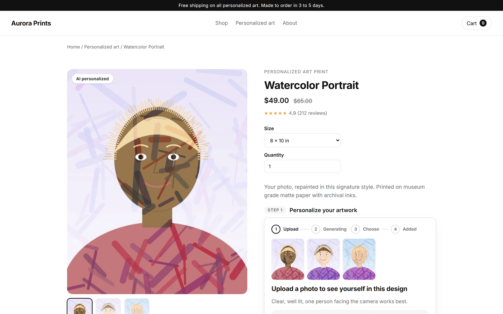

<p align="center"><em>The block on a product page: the customer uploads a photo and gets two AI previews without leaving the page.</em></p>

## How it works

1. **Upload.** On the Shopify product page the customer uploads a photo and gives consent. Large
   photos are resized in the browser before upload.
2. **Check.** The backend validates the photo (format, size, blur check), strips metadata and
   stores a normalized copy.
3. **Generate.** A background job sends the photo and the design's prompt and reference images to
   the AI model chosen for each preview slot.
4. **Compare.** Two watermarked previews appear side by side. The customer can retry, then chooses
   one.
5. **Add to cart.** The chosen preview is attached to the cart line. The theme's own buy buttons are
   hidden, so a personalized product can't be bought without a preview.
6. **Order.** Shopify order webhooks match the order to the preview, and the full resolution file is
   released once the order is paid.

## Screenshots

All screenshots come from the local demo, where a mock provider stands in for the AI model, so the
previews carry a "PREVIEW" watermark and a mock label.

### Customer flow

<table>
<tr>
<td width="50%">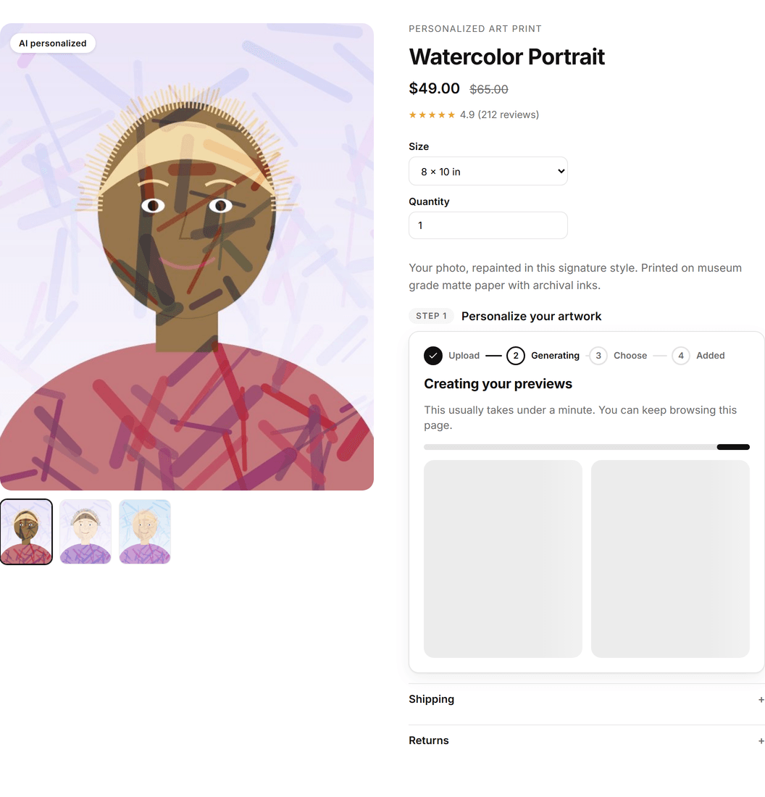</td>
<td width="50%">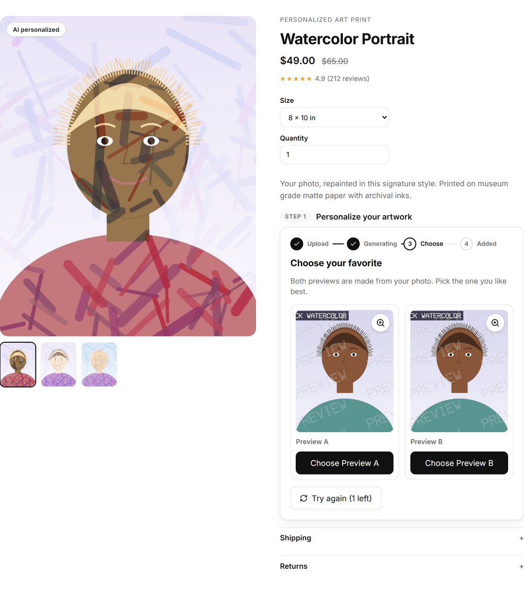</td>
</tr>
<tr>
<td align="center"><b>Generating.</b> Progress and placeholders while both slots run.</td>
<td align="center"><b>Choose.</b> Preview A and Preview B side by side, with one retry left.</td>
</tr>
<tr>
<td width="50%">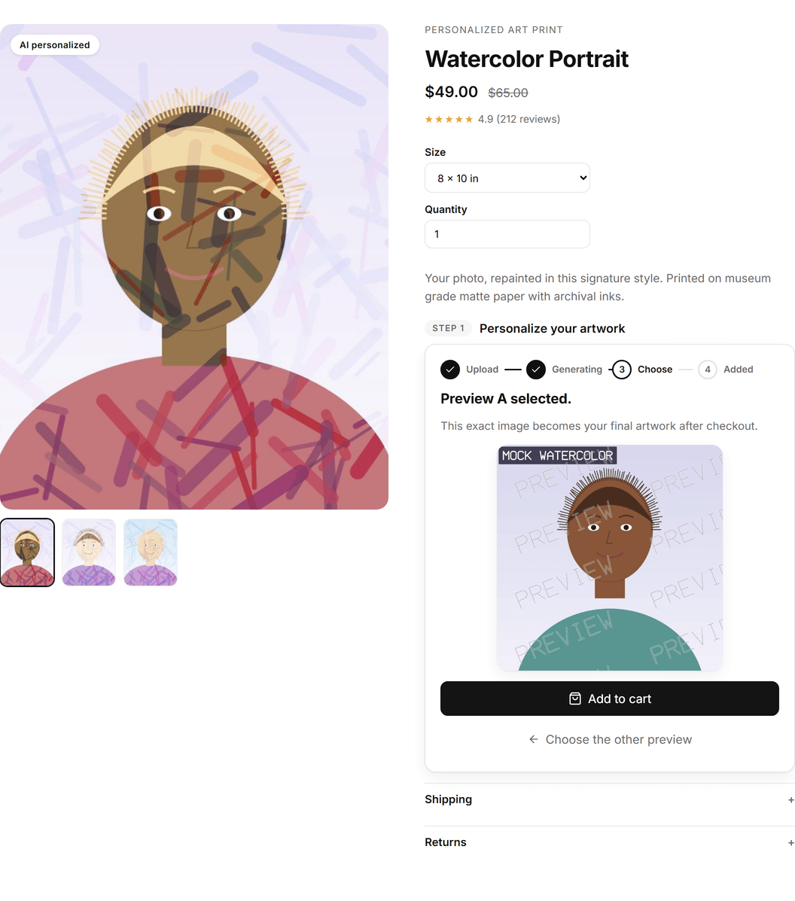</td>
<td width="50%">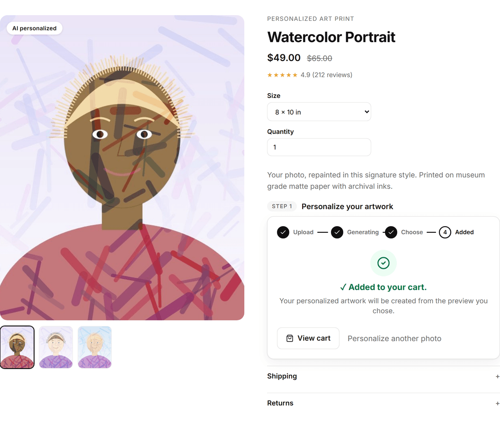</td>
</tr>
<tr>
<td align="center"><b>Selected.</b> The chosen artwork, ready to add to the cart.</td>
<td align="center"><b>Added.</b> The choice travels with the cart line to the order.</td>
</tr>
</table>

<p align="center">
  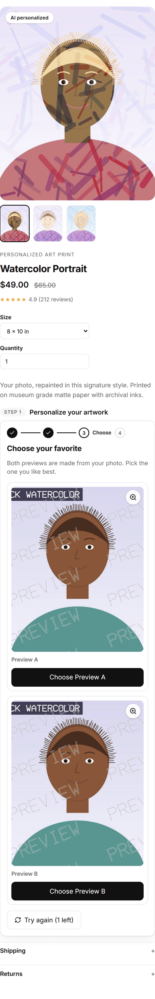
</p>
<p align="center"><em>The same step on a phone.</em></p>

### Admin panel

<table>
<tr>
<td width="50%">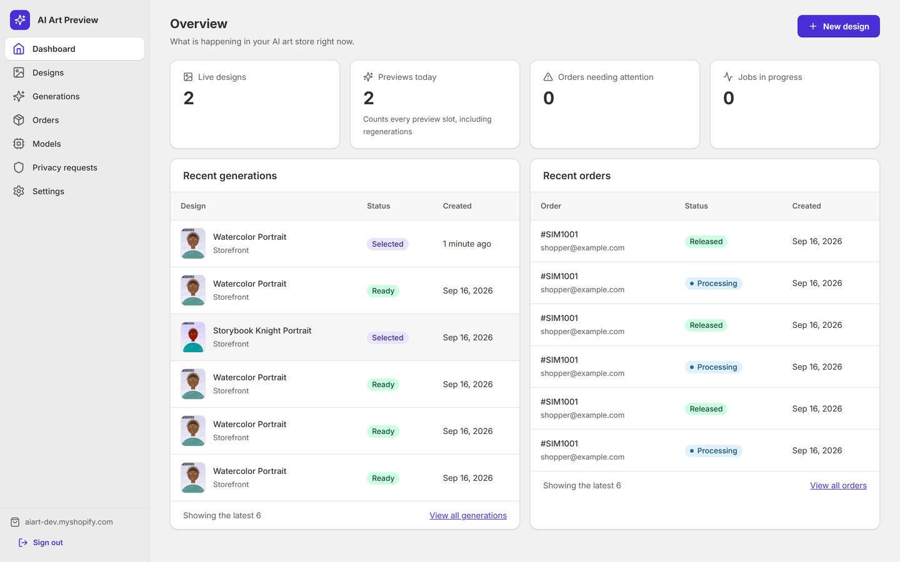</td>
<td width="50%">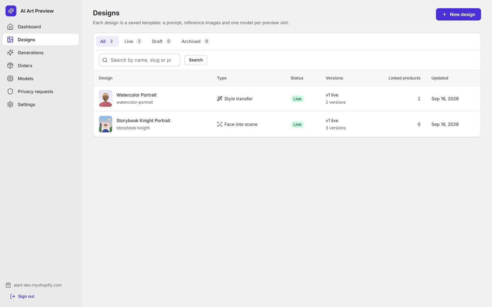</td>
</tr>
<tr>
<td align="center"><b>Dashboard.</b> Live designs, previews today, orders needing attention, recent activity.</td>
<td align="center"><b>Designs.</b> Every art style with its status, linked products and versions.</td>
</tr>
<tr>
<td width="50%">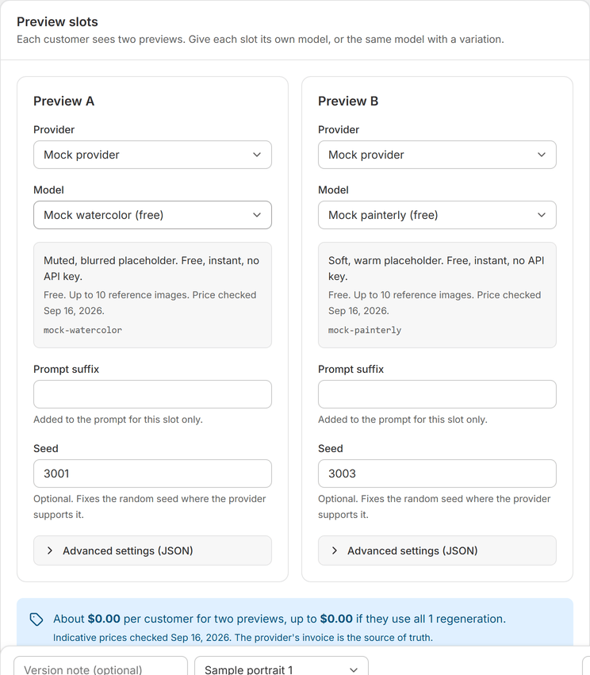</td>
<td width="50%">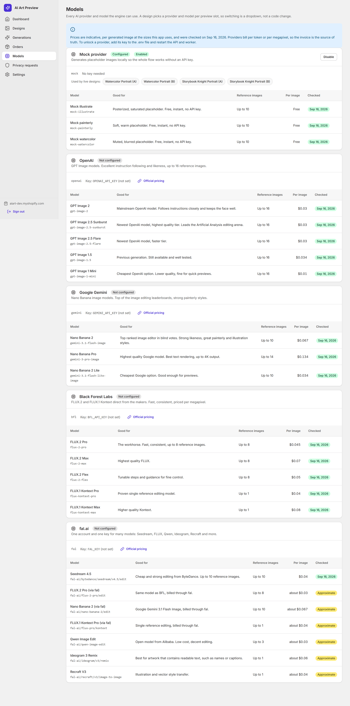</td>
</tr>
<tr>
<td align="center"><b>Model per slot.</b> Provider and model in a dropdown, with the estimated cost per customer.</td>
<td align="center"><b>Models.</b> Every provider and model, with indicative prices and the date they were checked.</td>
</tr>
<tr>
<td width="50%">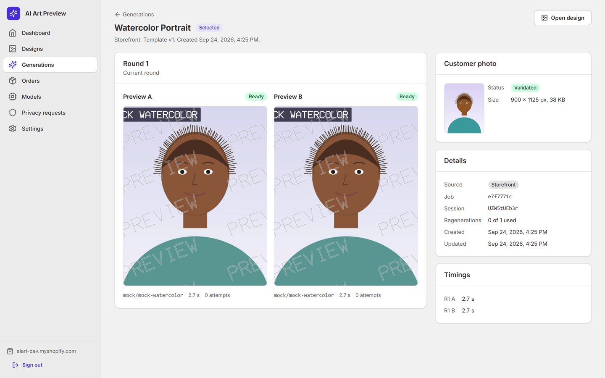</td>
<td width="50%">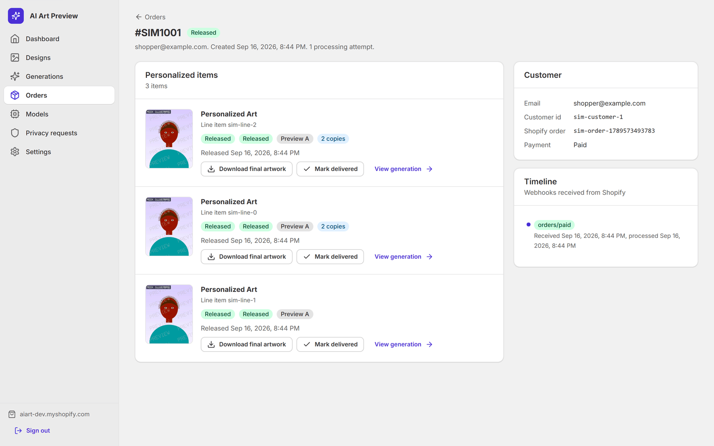</td>
</tr>
<tr>
<td align="center"><b>Generation.</b> Both previews with model, timings and attempts.</td>
<td align="center"><b>Order.</b> The chosen artwork, release status and the final file to download.</td>
</tr>
</table>

## Features

**Storefront (customer page)**
- Shopify **theme app extension** block that works with Online Store 2.0 themes, added in the theme
  editor
- Lightweight vanilla TypeScript widget (under 28 KB) served through the **Shopify app proxy**
- Photo upload with consent, client side resizing, loading states and mobile layout
- Reads size and quantity from the theme's product form

**Backend**
- **AI image generation** jobs in a queue, with retries, timeouts and a maintenance sweep
- Provider **webhooks** with signature checks, plus polling as a fallback
- Photo validation, metadata stripping, **watermarking** and presigned storage links
- **Shopify order webhooks**, HMAC verification, and release of the file after payment
- OpenAPI documentation

**Admin panel (embedded Shopify app)**
- Design manager: prompt, reference images, AI provider and model for each preview slot, limits,
  versions and test runs on sample photos
- Generations, Orders, Models (catalog with indicative prices), Settings and Privacy screens

**AI models and providers**
- **OpenAI** (GPT Image), **Google Gemini** (Nano Banana), **Black Forest Labs** (FLUX.2, FLUX
  Kontext) and **fal.ai** (Seedream, Qwen Image, Ideogram, Recraft and more)
- Models are data, not code: any slot can use any model id, so new models need no code changes

## Tech stack

TypeScript, Node.js, Shopify App (React Router 7, App Bridge, theme app extension, app proxy),
Fastify, BullMQ, Redis, PostgreSQL with Drizzle ORM, S3 compatible storage (MinIO, AWS S3,
DigitalOcean Spaces), Sharp, Zod, Vitest, Playwright, Biome, pnpm monorepo, Docker Compose.

## Prerequisites

- Node.js 22.12 or newer, and pnpm 11 (`corepack enable` gives you the pinned version)
- Docker Desktop, running

## Quick start

```bash
pnpm install
pnpm bootstrap
```

`pnpm bootstrap` creates `.env`, starts Postgres, Redis and S3-compatible storage in Docker, creates
the dev, test and e2e databases and buckets, runs migrations and seeds two sample designs. It's safe
to run again.

## Layout

| Path | What it is |
|---|---|
| `packages/contracts` | Browser-safe schemas, types and constants (design template, statuses, API shapes) |
| `packages/core` | Server-only engine: config, database, storage, images, security, templates, providers, queue, services |
| `apps/api` | Fastify backend: storefront endpoints behind the Shopify app proxy, webhooks, OpenAPI docs |
| `apps/worker` | Job queue workers: generation, finalizing previews, order processing, cleanup |
| `apps/storefront` | The preview widget, plus a local test product page that imitates Shopify |
| `apps/shopify-app` | Admin panel (embedded Shopify app) and the theme app extension |
| `tests/e2e` | Playwright end-to-end tests |

## Local services

| Service | URL |
|---|---|
| Admin panel | http://localhost:3000 |
| API (+ `/docs`) | http://localhost:4000 |
| Worker health | http://localhost:4001/health |
| Storefront test page | http://localhost:5173 |
| Postgres | `localhost:5433` (user and password `aiart`) |
| Redis | `localhost:6379` |
| Storage (S3 API / console) | http://localhost:9000 / http://localhost:9001 |

## Running it

```bash
pnpm dev
```

Starts the API, worker, storefront test page and admin panel together (each line prefixed by
service name; Ctrl-C stops all of them). Then open:

- **Storefront test page:** http://localhost:5173. Open a product from the shop list, upload a
  photo, tick the consent box and press "Create previews". Watch two mock previews generate, pick
  one, add it to the cart, and use the "Simulate order paid" button to see the file released.
- **Admin panel:** http://localhost:3000. Click "Continue as dev-store.myshopify.com" (local only
  sign in; see [docs/GO-LIVE.md](docs/GO-LIVE.md) for real Shopify auth), then edit a design, run a
  test on a sample photo, and check Generations, Orders, Models and Settings.
- **API docs:** http://localhost:4000/docs

Checks: `pnpm test`, `pnpm e2e` (with `pnpm dev` running), `pnpm typecheck` and `pnpm lint`.

## Common commands

| Command | Does |
|---|---|
| `pnpm bootstrap` | Local setup (see above) |
| `pnpm dev` | Run the API, worker, storefront and admin together |
| `pnpm test` | Unit and integration tests |
| `pnpm --filter @aiart/e2e test` | Playwright end-to-end test against the running stack (uses your installed Chrome, so no browser download is needed) |
| `pnpm typecheck` | TypeScript across all packages |
| `pnpm lint` | Biome lint and format check |
| `pnpm --filter @aiart/storefront build:widget` | Build the storefront widget, check its size and copy it into the theme extension |
| `AIART_VISUAL=1 pnpm --filter @aiart/e2e exec playwright test visual.spec.ts` | Screenshot every widget state at desktop and phone widths (for design review) |
| `pnpm db:generate` | Create a migration after changing the schema |
| `pnpm db:migrate` / `pnpm db:seed` | Apply migrations / reseed the dev database |
| `pnpm infra:down` | Stop the Docker services (data is kept in named volumes) |

## Going live

This repository runs entirely on a mock AI provider. [docs/GO-LIVE.md](docs/GO-LIVE.md) lists what
to plug in (a Shopify Partner account and dev store, real AI provider API keys, and public
hosting) and exactly which files and environment variables that touches.

## License

Copyright (c) 2026 Muhammad Amar Sohail. All rights reserved. The code is published so people can
view it as a portfolio example. It may not be copied, reused or sold without written permission.
See [LICENSE](LICENSE). If you need a similar custom Shopify AI app, get in touch through GitHub.
